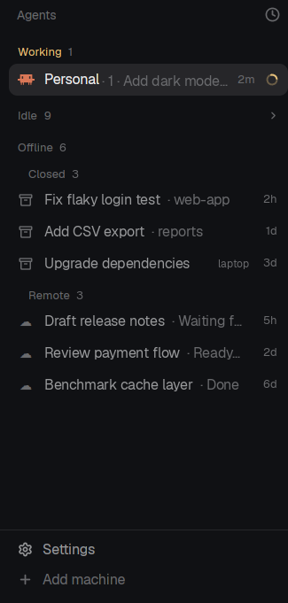

# idle-agent-manager

A mod for the [Herdr](https://herdr.dev) desktop app: its Agents list, plus an **Offline**
group for Claude Code sessions that aren't running.



| Section | What's in it | Click | Hover |
|---|---|---|---|
| **Interrupted** ⚠ | Sessions cut off by a reboot, crash or closed window that couldn't be resumed by themselves (needs the hooks below) | Resume in a new tab, in its old space | Hide · Delete |
| **Closed** | Every other session on this computer and on Herdr's connected machines | Resume in a new tab | Hide · Delete |
| **Remote** ☁ | Sessions on claude.ai with no copy on any machine | Open on claude.ai | Hide |

Delete asks for a second click and then removes everything Claude Code keeps for the
session (transcript, subagents, file-history, session-env, debug log, job folder, leftover
session files, scratch output, its prompt-history lines after a backup), on every machine
that has a copy. See [RECIPE.md](RECIPE.md) for every detail.

## What it touches

- **Runs programs**: `python3` (its own two scripts) here and, through herdr-core, on
  connected machines; `hc get`; `hc send` to type `claude --resume <id>` into a terminal
  whose session was cut off (only with the hooks below); `xdg-open` / `explorer.exe` to
  open claude.ai links.
- **Reads** outside its folder: `~/.claude/` (transcripts, session and job files, history),
  the restore records, and **Claude Code's login** (`~/.claude/.credentials.json`) to
  list your claude.ai sessions.
- **Network**: `GET https://api.anthropic.com/v1/code/sessions` only. That endpoint isn't
  documented; it's the one Claude Code uses, and may change.
- **Writes**: a cache in `~/.cache/claude-offline/`; restore records in
  `~/.local/state/claude-restore/sessions/` (the hooks); and, only when you confirm a Delete,
  removes that session's files and rewrites `~/.claude/history.jsonl` without its lines.

## Install

```sh
cp -r mods/idle-agent-manager ~/.config/herdr-app/mods/
herdr-app check ~/.config/herdr-app/mods/idle-agent-manager
```

Then point your layout's agents block at it. Herdr's `main` layout is read-only, so clone it
first:

```sh
herdr-app do layout.clone '{"name":"main","as":"my-layout"}'
# in ~/.config/herdr-app/layouts/my-layout.json, the "agents" block:
#   "content": { "mod": "idle-agent-manager" }
```

### Optional: restore sessions after a reboot or crash

Add two Claude Code hooks so the mod knows which terminal runs which session. In
`~/.claude/settings.json`:

```json
"hooks": {
  "SessionStart": [{ "hooks": [{ "type": "command", "command": "python3 -I \"$HOME/.config/herdr-app/mods/idle-agent-manager/offline.py\" track start", "timeout": 10 }] }],
  "SessionEnd":   [{ "hooks": [{ "type": "command", "command": "python3 -I \"$HOME/.config/herdr-app/mods/idle-agent-manager/offline.py\" track end", "timeout": 10 }] }]
}
```

When the window opens, the mod then types `claude --resume <id>` into every Herdr terminal
whose session was cut off and that came back as an idle shell, on this computer and on each
connected machine (once per machine, the first time it answers). Sessions it can't resume
that way show in **Interrupted**.

On a connected machine, copy `offline.py` anywhere there (say
`~/.local/share/idle-agent-manager/offline.py`) and add the same hooks with that path. The
mod itself installs nothing on other machines.

Without the hooks there's no Interrupted section and nothing is restored; the rest works.

## Tests

```sh
sh tests/run.sh
```

Runs the Python tests (`tests/test_offline.py`, `tests/test_claude_ai.py`) and, when Herdr is
installed, `herdr-app check` on the mod. The tests build a fake home folder with a fake `hc`
and never touch your real sessions or the network. The mod's JavaScript (merging, dedupe,
rows) is covered only by `herdr-app check` loading it, not by unit tests.

## Layout

```
mods/idle-agent-manager/  the mod (main.js, mod.json, offline.py, claude_ai.py)
tests/                    test set and runner
RECIPE.md                 the brief to rebuild it from scratch (Herdr's sharing format)
preview.png            screenshot
```

## License

[MIT](LICENSE)
