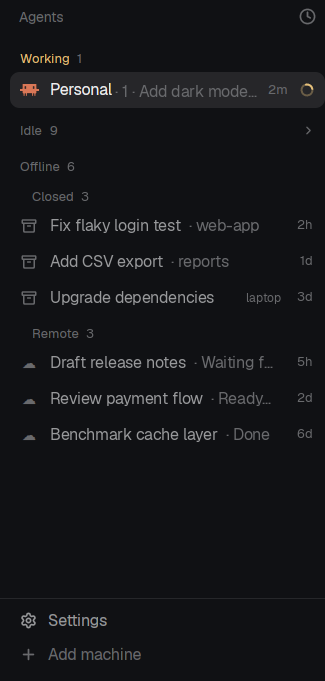

# Idle Agent Manager

Herdr's Agents list, plus an **Offline** group at the bottom for Claude Code sessions that
aren't running: sessions cut off by a reboot or crash (**Interrupted**), every other session
on this computer and its connected machines (**Closed**), and sessions that only exist on
claude.ai (**Remote**). Click a session to bring it back; hover it to hide or delete it.

## What you see

The sidebar's Agents block, top to bottom:

- **The live agents**, exactly as Herdr's `agents` mod draws them (Needs you, Done, Working,
  Idle, or grouped by space; pins, sub-agent trees, the sort menu, the narrow rail).
- **Offline** — a group header like the others (11 px, medium, `dim`), always with its
  count: Interrupted + Closed + Remote. Hidden when all three are empty.
- Inside it, up to three sub-headers, indented 18 px, 24 px tall, each with a count:
  - **Interrupted** — rows with a `⚠` in `blocked` color.
  - **Closed** — rows with `mods/workspace-chrome/archive.svg` (13 px, `dim`).
  - **Remote** — rows with a `☁` in `dim`.
- **Rows** are 30 px tall, 8 px padding, 8 px corners, 9 px gap, `hover` background on hover:
  - the icon (16 px column);
  - the title (`muted`, max 170 px, truncated): the `/rename` title, else Claude's own
    summary (ai-title), else the first typed prompt, else the folder's name. A `/rename`
    title shared by several rows is skipped, since it tells them apart from nothing;
  - the detail (`dim`, truncated): `· folder` (and `· t12`, the terminal, for Interrupted);
    for Remote, `· ` and claude.ai's status line;
  - the machine name (10 px, `dim`) for sessions on another machine;
  - on the right, the age (11 px, `dim`: `<1m`, `5m`, `3h`, `2d`), or on hover the buttons.
- **Tooltip** on each row: the full title, the folder, the machine, why it's interrupted
  (`waiting to restore`, `terminal busy (vim)`, `terminal gone`), and `folder missing` when
  the folder no longer exists.
- If claude.ai can't be reached or the login has expired and there's nothing to show,
  Remote shows one dim line: `claude.ai: <the error>`.

## How it behaves

- **Statuses** of live agents are untouched (working spinner, blocked "Needs you", done dot,
  idle ring). Offline rows have no status: their icon says which kind they are.
- **Click** a Closed or Interrupted row: a new tab runs `claude --resume <id>` in the
  session's folder (`claude --continue` for a restore record without a session id, whose
  record is then forgotten). The tab opens in the session's old space if it's still there,
  else in the current space if it's on the session's machine, else in another space on that
  machine, else in a new space there. The list refreshes 5 s later.
- **Click** a Remote row: opens `https://claude.ai/code/<id>` in the browser.
- **Hover** a row: `×` hides it (remembered in this mod's localStorage, `offHidden`).
  Closed and Interrupted rows also get **Delete** (**Forget** for a record without an id):
  the first click turns it into `Confirm delete` in `blocked` color for 3 s; a second click
  in that time deletes. Leaving the row cancels.
- **Delete** removes, on every machine that has a copy: the transcript, its side folder
  (subagents, tool output), `~/.claude/file-history/<id>`, `~/.claude/session-env/<id>`,
  `~/.claude/debug/<id>.txt`, `~/.claude/jobs/<first 8>/` (only if it's this session's),
  leftover `~/.claude/sessions/<pid>.json` and `.key` files, `/tmp/claude-<uid>/*/<id>`, the
  restore record, and the session's lines in `~/.claude/history.jsonl` (rewritten after a
  dated backup in `~/.cache/claude-offline/history-backups/`, kept 14 days). It refuses a
  running session.
- **Folding**: every header folds. Offline, Interrupted, Closed and Remote remember their
  fold (localStorage `offFold`); on a first start Closed is folded and the rest are open.
- **Grouped by space**: an Interrupted session whose space still exists sits in that space's
  group (a group is added if the space has no live agents); everything else stays in Offline.
- **Narrow rail**: no Offline rows.
- **Refresh**: machines every 30 s (and 5 s after a click), claude.ai every 2 minutes. A
  machine that fails keeps its last list.
- **Which list a session lands in**:
  - running anywhere (a live `~/.claude/sessions/<pid>.json` whose pid and start time match,
    or its restore record's terminal running `claude`): not listed;
  - a restore record whose terminal isn't running Claude: Interrupted;
  - any other transcript with a typed prompt, not headless (`entrypoint` starting `sdk`):
    Closed;
  - a claude.ai session, not archived, whose id no machine has in a transcript, session
    file or job: Remote.
  - The same transcript on two machines shows once: from where its folder exists, else the
    newest.

## Built from

- **Layout**: the layout's `agents` block points to `{ "mod": "idle-agent-manager" }`. Herdr's
  own `main` layout can't be edited; clone it first (`layout.clone`).
- **`mods/idle-agent-manager/`**, a `mod.clone` of Herdr's `agents` (0.1.16):
  - `main.js` — the shipped mod plus: `refreshOffline` (runs `offline.py list` on this
    computer and each machine from `machines()` not `unavailable`, with
    `exec("python3", ["-I", "-c", source, "list"], { on, timeout: 60000 })`; the source is
    read once with `readTextFile(appHome() + "/mods/idle-agent-manager/offline.py")`, so nothing
    is installed on other machines), `refreshCloud` (runs `claude_ai.py list` locally),
    `offlineItems` / `remoteItems` (merge, dedupe, filter), `resume` (`tab.new
    {space, folder, argv}` or `space.new {machine, folder, argv}`), `offlineRow` /
    `remoteRow`, and the Offline headers built with the shipped `header()`. Uses `exec`,
    `readTextFile`, `appHome`, `machines`, `spaces`, `focused`, `run`, `notify`, `checking`.
  - `offline.py` — `list`, `delete <id>`, `forget <record>`. Reads `~/.claude/projects`,
    `~/.claude/sessions`, `~/.claude/jobs`, the restore records, and `hc get <t> --json`.
    Caches per-transcript facts in `~/.cache/claude-offline/meta.json` (keyed by mtime and
    size), so a list costs about 0.1 s after the first.
  - `claude_ai.py` — `list` (and `probe`, the response's shape). GETs
    `https://api.anthropic.com/v1/code/sessions` (100 a page, up to 10 pages, following
    `next_cursor`) with Claude Code's login from `~/.claude/.credentials.json` and the
    organization from `~/.claude.json`. Read-only.
- **Optional, for Interrupted**: the claude-restore hooks in `extras/claude-restore/`
  (SessionStart/SessionEnd hooks write and clear `~/.local/state/claude-restore/sessions/
  <id>.json` with the terminal, folder and space; a background mod resumes them when the
  window opens. It draws nothing and sits in the layout's `floating` list, so it takes no
  space). Without them there is no Interrupted section; the rest works.
- **Art**: Herdr's `mods/workspace-chrome/` icons (`archive.svg`, `x.svg`, chevrons).

## Watch out

- **Don't edit `mods/agents/`**: Herdr restores its shipped mods on every start and moves
  your edit to `agents-edited`. Clone with `mod.clone`.
- **claude.ai's endpoint isn't documented.** It's the one Claude Code uses (`/v1/sessions`
  is retired; Claude Code itself falls back to `/v1/code/sessions`). It may change with a
  Claude Code update; the section then shows the error. The access token expires and Claude
  Code refreshes it; with no Claude Code run for a while, Remote says to sign in again.
- **Remote filtering needs the other machines.** A claude.ai session started on a machine
  that's unreachable shows in Remote until that machine answers once. The lists aren't kept
  across a reload of the mod.
- `offline.py` is passed with `-c`; keep it self-contained (no imports from its folder).
- Running detection reads `/proc/<pid>/stat` (Linux). Without `/proc` it only checks that
  the pid exists, so a reused pid can make a session look running.
- `herdr-app check` runs `init()` for real: both refreshes return early when `checking()`.
- A restore record without a session id (written for sessions that were already running
  when the hooks were set up) resumes with `claude --continue`, which picks the folder's
  newest session.
- Opening a URL tries `xdg-open`, then `explorer.exe` (WSL).
- Delete removes local files only. The claude.ai copy of a Remote Control session stays
  there; there is no delete for Remote rows.

## Done when

- `herdr-app check mods/idle-agent-manager` passes, and `sh tests/run.sh` passes.
- With the layout pointing at the mod, the Agents block shows the live agents as before and
  an Offline group under them with Closed (folded) and Remote counts.
- A session you exit with `/exit` shows in Closed within 30 s; resuming it from its row opens
  a tab running `claude --resume <id>` in its folder, and the row goes away.
- A session in a terminal that loses Claude (kill the claude process) shows in Interrupted
  with `⚠`, its terminal id and `waiting to restore`.
- Hover a row: `×` hides it and it stays hidden after a restart; Delete needs a second click
  within 3 s, then the transcript and its files are gone (`ls ~/.claude/projects/*/<id>*`).
- Remote lists the claude.ai sessions that `claude_ai.py list` returns minus those with a
  local transcript; clicking one opens it on claude.ai.
